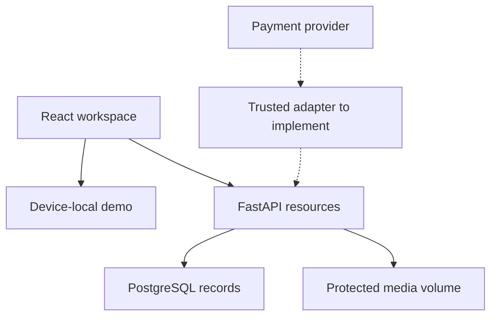

# Product and architecture

Celaine has two primary roles: a creator owns and publishes a music idea; a buyer licenses another creator's material. The same account may do both. Ownership is enforced on the server, not by hiding interface controls.

The initial release supports hooks, lyrics and song sketches. It intentionally does not assign song royalties, negotiate publishing splits, charge cards, or pay sellers automatically.

## Relational design

| Table              | Purpose                                          | Important integrity rule                                                             |
| ------------------ | ------------------------------------------------ | ------------------------------------------------------------------------------------ |
| `users`            | Private account data and public creator profile  | Unique normalized email and username                                                 |
| `refresh_sessions` | Opaque rotating refresh credentials              | Only token hashes stored; revoked sessions invalidate access tokens                  |
| `ideas`            | Creator-owned lyrics, metadata and listing       | Creator foreign key; bounded prices; constrained lifecycle and license type          |
| `reactions`        | User's current like/save state                   | Unique user + idea + kind; PUT establishes an explicit active state                  |
| `interactions`     | Daily views and plays                            | Unique actor + idea + kind + day                                                     |
| `comments`         | Creative conversation                            | Author and idea foreign keys; only author may delete                                 |
| `follows`          | Creator subscriptions                            | Unique follower + creator; cannot follow yourself                                    |
| `notifications`    | Saves, likes, follows, feedback and licenses     | Visible only to the intended account                                                 |
| `orders`           | Purchase attempt and immutable licensed material | Buyer-scoped idempotency key, seller/buyer references, price/terms/content snapshots |
| `payment_events`   | Fulfillment replay protection                    | Unique trusted-provider event ID                                                     |

Amounts are integer cents in USD. Supporting another currency requires its own rounding, display, provider and settlement policy; changing the code's symbol alone is insufficient.

## Idea lifecycle

- `draft`: visible only to its creator; may contain unfinished material.
- `published`: searchable and available to license; requires a description, lyrics or preview, and a price of at least $1.
- `sold`: an exclusive license has been fulfilled. Other visitors may inspect its preview but cannot buy it.
- `archived`: omitted from discovery; previously licensed buyers retain access to their purchase.

Active or paid orders lock the listing's content and commercial fields. A creator must create a new idea/version to change material already licensed. Archiving a paid idea keeps its order records and purchase downloads intact.

The editor stages new file-backed work as a private draft, uploads the files, and publishes only after the attachments have succeeded. A failed upload leaves a recoverable draft rather than an incomplete public listing.

## Purchase lifecycle

An authenticated buyer creates an order with an idempotency key. The server supplies the price, currency, seller, license terms and material snapshots; the client cannot choose them. An order expires after 30 minutes. The same active or paid idea/buyer combination is returned rather than sold twice.

Exclusive orders reserve the idea through an atomic conditional database update. PostgreSQL also locks the idea row, serializing publication edits and competing orders. Cancellation releases the reservation. After expiry a new order may reserve it; an expired order cannot subsequently be fulfilled. A paid exclusive order changes the idea to `sold` in the same transaction.

Fulfillment updates the order, the exclusive listing when applicable, and both parties' notifications together. Replayed events cannot create a second sale. Failed or late provider payments require operator reconciliation/refund; they do not grant access.

## Access rules

| Resource                           | Anonymous visitor | Signed-in writer    | Creator or paid buyer |
| ---------------------------------- | ----------------- | ------------------- | --------------------- |
| Public idea preview and excerpt    | Read              | Read                | Read                  |
| Private draft                      | No                | No, unless owner    | Creator only          |
| Full lyrics/original audio         | No                | No, unless entitled | Read                  |
| Create/edit/archive an idea        | No                | Own material only   | Creator only          |
| Likes, saves, comments and follows | No                | Act as self         | Act as self           |
| Analytics/notifications            | No                | Own only            | Own only              |
| License ZIP                        | No                | Paid buyer only     | Paid buyer only       |

Authenticated media previews are fetched with a bearer token and played from an object URL, so drafts do not need public URLs or credentials embedded in a media URL.

## Authentication and request behavior

Passwords use Argon2. Access tokens expire after 15 minutes and remain in memory. The refresh token is an opaque random value in an httpOnly SameSite cookie; the server stores its SHA-256 hash, rotates it, and revokes it at logout. Requests coordinate a single refresh rather than racing multiple rotations. A session check on access requests makes logout effective immediately.

Cookies and request origins are constrained, and CORS uses an explicit allowlist. Production configuration rejects insecure cookies, missing explicit JWT secrets, demo payment switches and SQLite.

Login/registration have a small process-local limiter. It is development protection, not a distributed abuse-control solution. Multi-worker deployments need a shared limiter.

## Analytics semantics

A listener contributes at most one view and one play to an idea each UTC day. The creator's own actions do not inflate these counts. For guests, a daily keyed hash of their network address deduplicates events without persisting the original address. This is approximate audience measurement, not verified unique people or bot detection.

Interval cards use the selected 7/30/90-day window. Likes and saves are current totals; the per-idea table is lifetime activity. Creator revenue counts paid orders once. Card counters are aggregated in batches rather than one count query per listing.

## Growth boundaries

Discovery APIs have bounded pagination; the first interface fetches up to 100 items per scope. A larger catalog should add visible server pagination, server-side filtering and proper indexed search. Comments and notifications are also capped. The current MVP uses a synchronous SQLAlchemy session per request, bounded media files and one local media volume. These choices suit a small deployment; object storage, a job queue for media processing, shared rate limiting and payment reconciliation are the next infrastructure changes.
